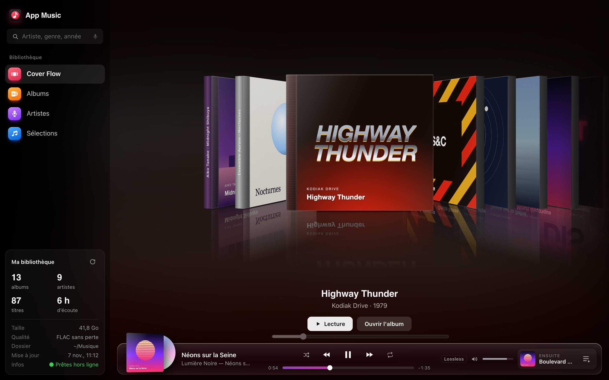
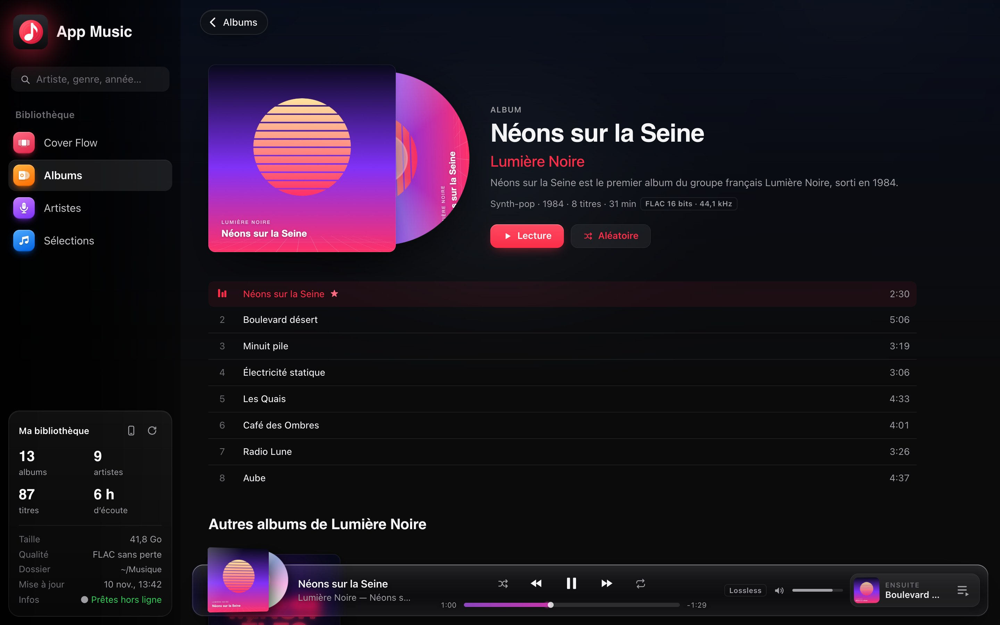
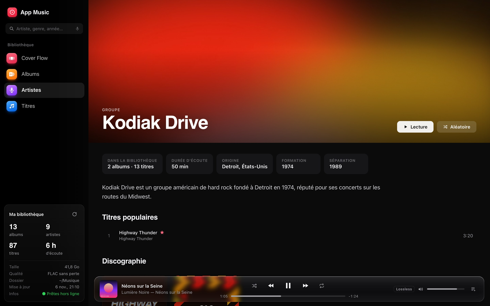
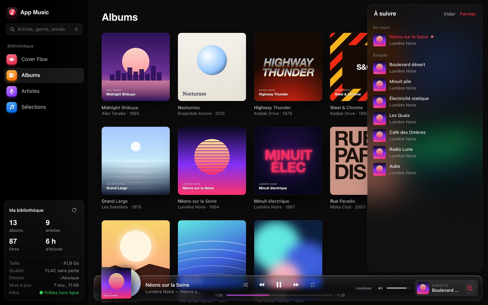
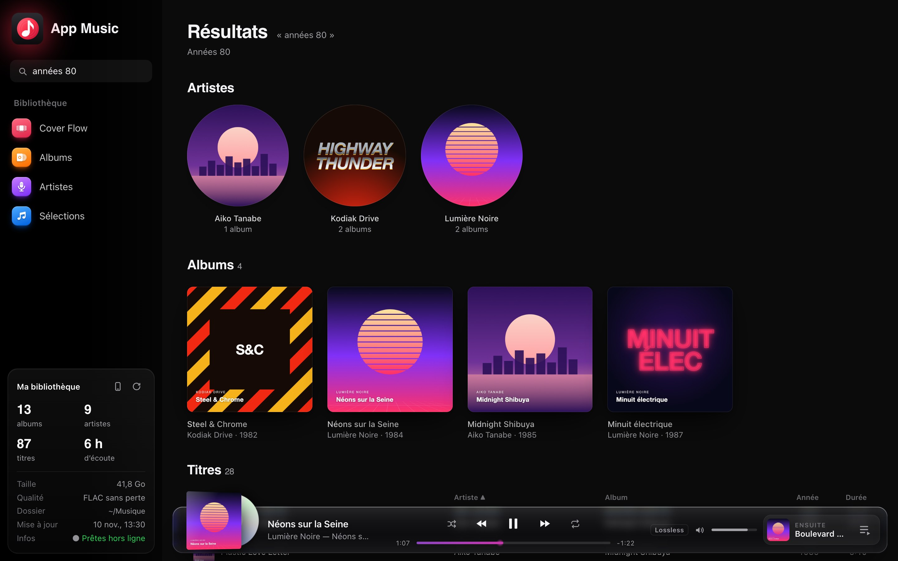
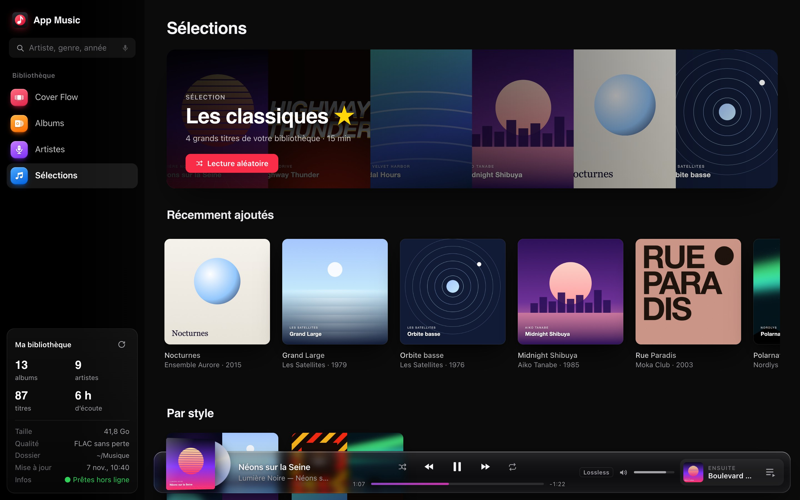
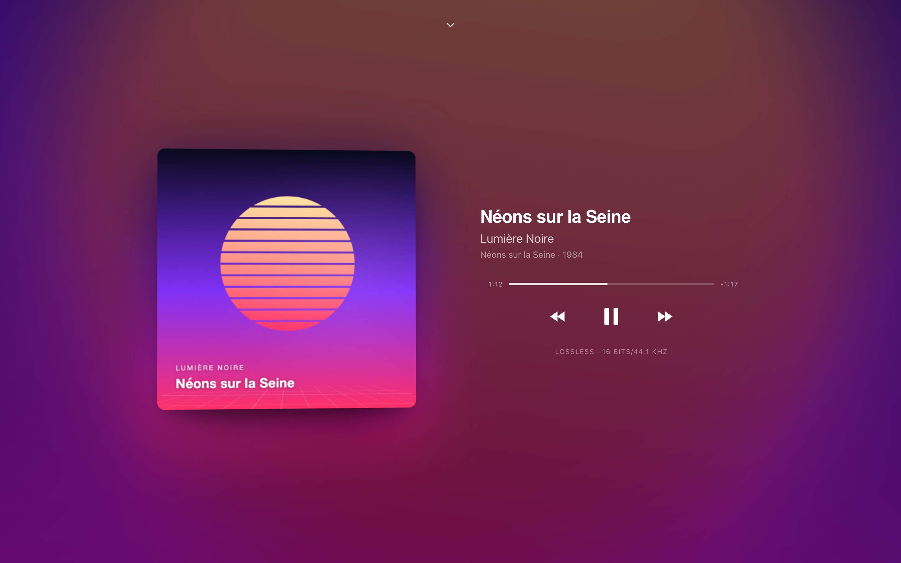

<div align="center">

# App Music

**Votre musique FLAC, belle comme au premier jour.**<br>
Un lecteur local pour macOS, Linux et Windows, dans l'esprit des apps Apple : Cover Flow en boîtiers CD 3D, fiches d'artistes,
recherche qui comprend « metal allemand des années 80 », et zéro dépendance au cloud.

   



</div>

## Pourquoi App Music

- **Vos fichiers restent intacts.** L'app lit les FLAC et MP3 là où ils sont : aucun déplacement, aucun renommage, aucune réécriture de tags.
- **Hors ligne, pour de vrai.** Les pochettes, biographies et photos sont téléchargées une seule fois. Ensuite, plus besoin d'Internet.
- **Pensée pour le canapé.** Tout se pilote au clavier ou à la télécommande.
- **Lossless d'abord.** Le format exact est affiché partout : 16 bits/44,1 kHz, 24 bits/96 kHz.

<table>
  <tr>
    <td width="50%"><br><b>Albums</b> : pochette inclinable, disque qui tourne pendant l'écoute, présentation en une phrase, titres très connus marqués ★.</td>
    <td width="50%"><br><b>Artistes</b> : photo, origine, années d'activité, biographie, titres populaires et discographie.</td>
  </tr>
  <tr>
    <td width="50%"><br><b>À suivre</b> : glissez un titre ou un album entier dans la file, réorganisez-la, videz-la.</td>
    <td width="50%"><br><b>Recherche</b> : fautes de frappe, sigles (« rhcp »), décennies, années, pays, genres.</td>
  </tr>
  <tr>
    <td width="50%"><br><b>Sélections</b> : les classiques ★, les albums récemment ajoutés, des playlists toutes prêtes par style et par décennie.</td>
    <td width="50%"><br><b>À l'écoute</b> : plein écran, couleurs tirées de la pochette, touches multimédia du clavier.</td>
  </tr>
</table>

<sub>Captures réalisées avec une bibliothèque de démonstration : artistes, albums et pochettes inventés (`npm run screenshots`).</sub>

## Installation

**macOS et Linux** : ouvrez un terminal (sur Mac : ⌘ Espace, « Terminal ») et collez cette ligne :

```sh
curl -fsSL https://raw.githubusercontent.com/pchartie/app-music/main/install.sh | sh
```

**Windows** : ouvrez **PowerShell** (menu Démarrer, « PowerShell ») et collez cette ligne :

```powershell
irm https://raw.githubusercontent.com/pchartie/app-music/main/install.ps1 | iex
```

Et c'est tout. Node.js est téléchargé si besoin (sans droits administrateur), puis l'app est installée dans le dossier
personnel (`AppMusic`) et s'ouvre dans le navigateur. Ensuite, il suffit de double-cliquer sur **App Music** sur le bureau.
Relancer la même ligne met l'app à jour, en gardant le cache et le dossier de musique.

Au premier lancement, un écran d'accueil demande le dossier qui contient la musique : fenêtre de choix de dossier du système,
chemin à saisir, ou dossiers détectés automatiquement (dossiers personnels, disques externes et clés USB).
Ce dossier reste modifiable depuis la colonne de gauche (ligne « Dossier »).
L'app crée aussi son raccourci, une seule fois : `~/Applications/App Music.app` et sa copie sur le bureau (macOS),
le menu des applications et le bureau (Linux), le menu Démarrer et le bureau (Windows).
Si vous le supprimez, il n'est pas recréé, et `npm run make-app` le refait.

| | macOS | Linux | Windows |
|---|---|---|---|
| Choix du dossier | Finder | zenity (GNOME…) ou kdialog (KDE), sinon chemin à saisir | Explorateur |
| Raccourci | app dans `~/Applications` + bureau | menu des applications + bureau | menu Démarrer + bureau |
| Téléphone : rester éveillé | `caffeinate` | `systemd-inhibit` | réglage d'alimentation de Windows |

**Comment ça marche.** `server.js` est un petit serveur local (127.0.0.1:4321, invisible depuis le réseau) qui indexe la musique
et sert l'audio, les pochettes et les fiches. L'interface est une page web ouverte dans votre navigateur par défaut.

## Hors ligne

- L'interface ne lit que le cache local et ne contacte jamais Internet.
- Le dossier de musique est surveillé : un album ajouté est indexé environ 20 s après la fin de la copie, puis ses infos sont
  récupérées une seule fois. Les présentations viennent de MusicBrainz, Wikidata et Wikipédia, les photos de TheAudioDB,
  le label et la popularité des titres de Deezer. Sans réseau, un nouvel essai a lieu toutes les 15 minutes.
- `npm run sync` indexe, télécharge ce qui manque, puis s'arrête.
- Tout ce qui est calculé ou téléchargé (miniatures, fiches, photos) va dans `cache/`, que vous pouvez supprimer sans risque.

## Recherche

Quelques mots suffisent, même approximatifs : `metalica`, `rhcp`, `acdc`, `années 80`, `80s`, `86`,
`entre 1975 et 1980`, `metal allemand`, `groupe suédois`, `rap`, `chanson française`, `hard rock 90`.
« joue … » ou « lance … » démarre directement la lecture du meilleur résultat.

Une étoile ★ signale les grands classiques, c'est-à-dire les titres classés au moins 800 000 en popularité sur Deezer
(*Nothing Else Matters*, *Seven Nation Army*, *Mistral gagnant*…). Chaque page d'artiste commence par ses titres populaires.

## Sélections

La page **Sélections** réunit des playlists toutes prêtes, calculées à partir de votre bibliothèque :
- **Les classiques ★** : vos titres très connus, du plus célèbre au moins célèbre ;
- **Récemment ajoutés** : les derniers albums arrivés dans le dossier de musique ;
- **par style** (rock, metal, pop, rap, chanson française, classique…) : un style apparaît dès qu'il compte 2 albums et 20 titres ;
- **par décennie** (années 70, 80, 90…), dans l'ordre chronologique.

Le bouton ▶ d'une carte lance la playlist en aléatoire. Un clic sur la carte ouvre la liste des titres.

## Albums en MP3

Un petit triangle ⚠ discret signale les albums dans un format avec perte (MP3, AAC…), sous la pochette et sur la page de l'album.
Le panneau « Ma bibliothèque » indique leur nombre et ouvre une page qui les rassemble. L'app y tient un journal : la date
à laquelle chaque album a été repéré et, une fois remplacé par du FLAC, la date à laquelle il ne l'est plus.
Le bouton **Télécharger la liste des fichiers** donne un CSV (Numbers, Excel) de tous les fichiers concernés, avec leur emplacement.

**Qualité réelle (faux 320).** Un MP3 peut afficher 320 kb/s et venir d'une source bien moins bonne, réencodée à un débit
plus élevé. L'encodeur coupe les aigus selon son débit (≈ 16 kHz à 128 kb/s, ≈ 19 kHz à 192, 20 kHz et plus à 320) et un
réencodage garde la coupure de la source : l'app mesure donc, sur le spectre de chaque MP3, où s'arrêtent les aigus.
Chaque album reçoit un verdict, **faux** (source ≤ 160 kb/s), **gonflé** (source ≈ 192) ou **conforme**, et la page
classe les albums à remplacer en premier. L'analyse est **facultative** : désactivée à l'installation, elle se lance avec le
bouton **Analyser la qualité réelle** de la page, qui indique la durée à prévoir (environ une minute pour 350 titres, plusieurs
heures pour une très grande bibliothèque) ; **Arrêter** ou **Ne plus analyser** la désactivent. Une fois activée, elle tourne
en arrière-plan après chaque indexation, sans connexion ; les fichiers ne sont que lus, et un titre n'est réanalysé que s'il
change. Le CSV donne le verdict de chaque titre.

## Téléphone (télécommande)

Pilotez App Music depuis un téléphone Android, sur le Wi-Fi de la maison : la musique continue de sortir de l'ordinateur.

1. Dans App Music, cliquez sur l'icône du téléphone, à côté de « Ma bibliothèque », puis sur **Associer un téléphone**.
2. Scannez le QR code avec l'appareil photo du téléphone : App Music s'ouvre dans Chrome, le téléphone est associé.
3. Pour retrouver l'app d'un geste : menu ⋮ de Chrome → **Ajouter à l'écran d'accueil**.

Sur le téléphone : albums, artistes, sélections, recherche, lecture en cours (position, volume, aléatoire, répétition)
et « À suivre » (ajouter, sauter à un titre, retirer). Si App Music est fermée sur l'ordinateur, le bouton
**Ouvrir sur le Mac** (ou sur le nom de l'ordinateur, sous Linux et Windows) la rouvre, puis exécute la demande en attente. L'ordinateur reste éveillé jusqu'à 1 h après la
dernière action du téléphone (l'écran peut s'éteindre ; capot fermé, un portable se met quand même en veille).

Sécurité :
- App Music ne s'ouvre au réseau que sur le Wi-Fi de la maison, reconnu à l'adresse matérielle de la box,
  et seulement s'il y a un téléphone associé. Ailleurs (café, train), elle reste invisible, comme avant ;
- chaque téléphone reçoit sa propre clé, en scannant un code valable 3 minutes et utilisable une seule fois ;
  on peut le retirer à tout moment depuis le même panneau ;
- le choix du dossier, l'actualisation et l'association restent réservés à l'ordinateur ; le téléphone ne reçoit
  jamais les fichiers audio.

Si le téléphone n'arrive pas à se connecter : macOS ou Windows peut demander, la première fois, d'autoriser les connexions
entrantes (acceptez ; sous Windows, pour les réseaux **privés**) ; un VPN peut bloquer le réseau local (autorisez « les connexions au réseau local » dans ses réglages).

## Clavier et télécommande

| Touche | Action |
| --- | --- |
| Flèches | Se déplacer (Cover Flow : album précédent / suivant) |
| Entrée / OK | Ouvrir, lancer la lecture |
| Échap / Retour arrière | Revenir, fermer |
| Espace / ⏯ | Lecture / pause |
| ⏭ ⏮, ⌘→ ⌘← | Titre suivant / précédent |
| Une lettre | Commencer une recherche |
| * (sur un titre) | Ajouter ou retirer son étoile ★ (aussi en cliquant dessus) |

Sur le curseur de position ou de volume, ← et → avancent de 10 s ou règlent le volume.

## Développement

```sh
git clone https://github.com/pchartie/app-music ~/AppMusic && cd ~/AppMusic
npm install
npm start          # serveur au premier plan (npm run app : en arrière-plan + navigateur ; -- --restart pour le relancer)
npm test           # toute la batterie de tests (~25 s)
```

**Tests.** Les tests tournent sur une bibliothèque factice générée à la volée (vrais FLAC 16/44,1 et 24/96, MP3, pochettes),
sans jamais toucher à votre musique. Ils couvrent :
- le serveur : indexation, regroupements, plages audio, confidentialité des chemins, mode hors ligne ;
- la recherche ;
- les grandes bibliothèques : lecture des fichiers en parallèle, barre de progression de la première indexation, défilement sans relief 3D au repos ;
- l'interface, dans Brave, Chrome ou Chromium sans fenêtre : lecture, file « À suivre », clavier, absence de ressources externes ;
- la télécommande : réseau simulé, association par QR code (lu par un vrai décodeur), clés, accès refusés,
  puis un ordinateur et un téléphone simulés côte à côte.

Pour imposer un navigateur : `APPMUSIC_BROWSER=/chemin/vers/chrome`.

**Grande bibliothèque.** Mesuré sur 19 200 MP3 (1 500 albums) : première indexation en ≈ 20 s sur un SSD (plus long sur un
disque externe), réindexation sans changement en 0,5 s, défilement de la page Albums à 60 images/s. Les captures de cette page se régénèrent avec `npm run screenshots`.
L'icône (`public/icon.svg`, aussi utilisée comme favicon) se convertit en icônes de raccourci avec `npm run make-icon`
(`assets/AppIcon.icns` pour macOS, `.ico` pour Windows, `.png` pour Linux ; installées par `npm run make-app`).

**Organisation du code.**

- `server.js` : indexation, audio, cache, synchronisation des métadonnées
- `public/app.js` : interface (vues, Cover Flow, lecteur, file d'attente)
- `public/search.js` : moteur de recherche (fautes de frappe, sigles, décennies, genres, pays)
- `public/mixes.js` : sélections (classiques, playlists par style et par décennie)
- `public/keynav.js` : navigation spatiale au clavier et à la télécommande
- `public/glass.js` : effet de verre liquide du lecteur (réfraction, dispersion)
- `public/remote-panel.js` : panneau « Télécommande » de l'ordinateur (QR code, appareils, réseau de la maison)
- `public/m/` : l'app du téléphone (`npm run make-phone-icons` régénère ses icônes)
- `lib/remote.js` : association, clés d'appareil, réseau de la maison, canal en direct téléphone ↔ ordinateur
- `lib/system.js` : tout ce qui dépend du système (réseau de la maison, anti-veille, navigateur, choix du dossier, disques externes), macOS, Linux et Windows
- `lib/images.js` : pochettes et photos réduites en JPEG (sharp)
- `lib/spectrum.js` : qualité réelle des MP3 (coupure des aigus, décodage mpg123 en WebAssembly, dans un fil séparé)
- `lib/qr.js` : QR code fabriqué localement
- `scripts/` : lanceur (`launch.mjs`), raccourcis (`make-app.mjs`), icônes, captures d'écran
- `scripts/flac-16bit.mjs` : outil à part (pas utilisé par l'app) qui copie un dossier de FLAC 24 bits en FLAC 16 bits / 44,1 ou 48 kHz,
  étiquettes et pochettes comprises, sans toucher aux originaux (nécessite sox et flac)
- `install.sh` (macOS, Linux) et `install.ps1` (Windows) : installation en une ligne
- `tests/` : batterie de tests et générateur de bibliothèque factice

Variables utiles :
- `PORT` : port du serveur ;
- `MUSIC_DIR` : dossier de musique, prioritaire sur `config.json` ;
- `APPMUSIC_CONFIG` et `APPMUSIC_CACHE` : emplacements de la config et du cache ;
- `APPMUSIC_OFFLINE=1` : simule l'absence de réseau ;
- télécommande (tests) : `APPMUSIC_FAKE_NETWORK` (réseau simulé), `APPMUSIC_LAN_PORT`, `APPMUSIC_NET_INTERVAL`,
  `APPMUSIC_PAIR_TTL`, `APPMUSIC_OPEN_LOG`.

